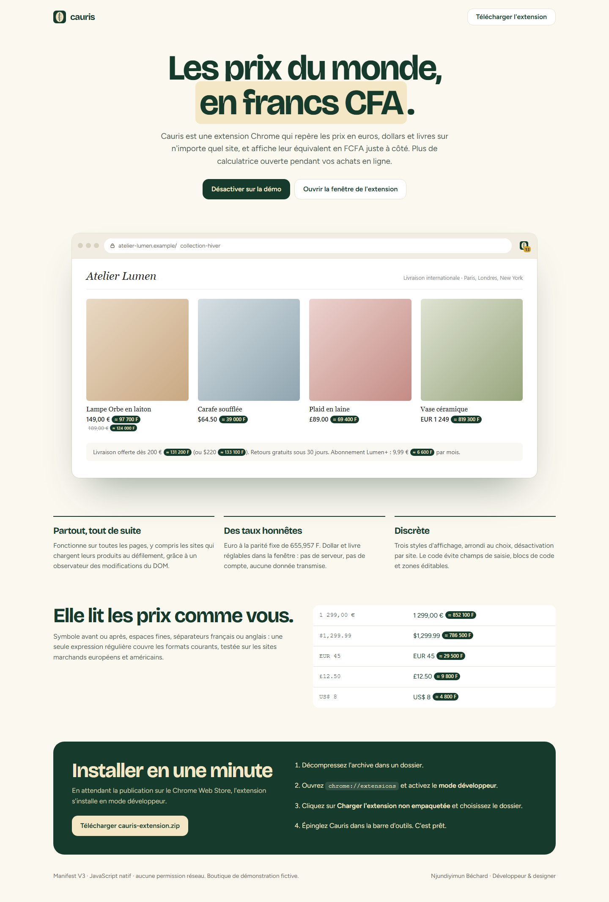
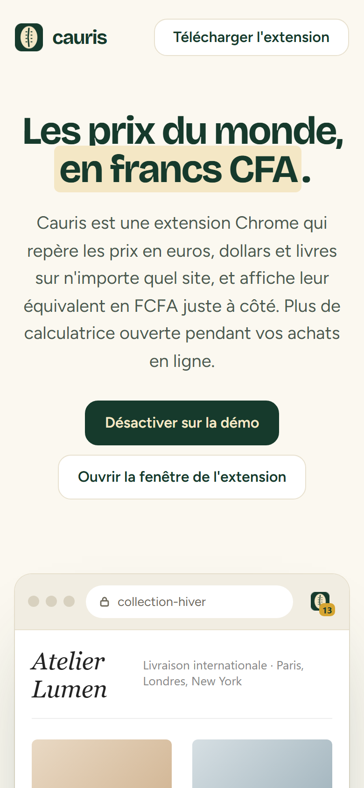

# Cauris

**Extension Chrome (Manifest V3)** — Extension Chrome qui détecte les prix en euros, dollars et livres sur n'importe quelle page et affiche leur équivalent en francs CFA à côté, avec une fenêtre de réglages et un convertisseur. Démo en direct avec le vrai script de l'extension sur une boutique fictive.

**Démo en ligne : [https://lordlennyx.github.io/cauris-extension/](https://lordlennyx.github.io/cauris-extension/)**

Spot de présentation (30 s) : [media/spot-30s.mp4](https://lordlennyx.github.io/cauris-extension/media/spot-30s.mp4)

## Ce que le projet montre

- Détection des prix dans le texte de la page : symbole avant ou après, séparateurs français et anglais, espaces fines
- Euro à la parité fixe 655,957 ; dollar et livre réglables ; arrondi au franc, à 50, 100 ou 1 000 F
- Pages dynamiques prises en charge (MutationObserver), champs de saisie, code et zones éditables ignorés
- Fenêtre de l'extension : activation, convertisseur, taux, trois styles d'affichage, désactivation par site, compteur de prix
- Manifest V3, une seule permission (storage), aucune requête réseau, mode sombre

## Réalisation

- **Stack :** JavaScript natif, Manifest V3, chrome.storage, HTML/CSS
- **Installer :** Télécharger cauris-extension.zip, chrome://extensions, mode développeur, « Charger l'extension non empaquetée »
- **Compatible :** Chrome, Edge, Brave, Opera (Chromium)

| Bureau | Mobile |
|---|---|
|  |  |

---

Client et contenus fictifs, créés pour la démonstration. Conception, design et développement : **Njundiyimun Béchard** — [github.com/LordLennyx](https://github.com/LordLennyx)
